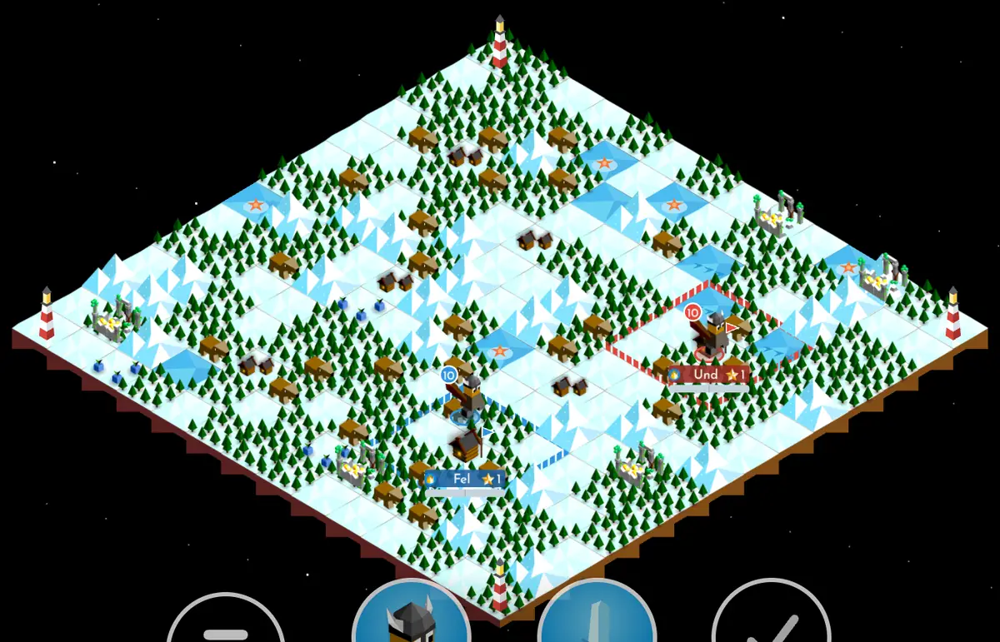
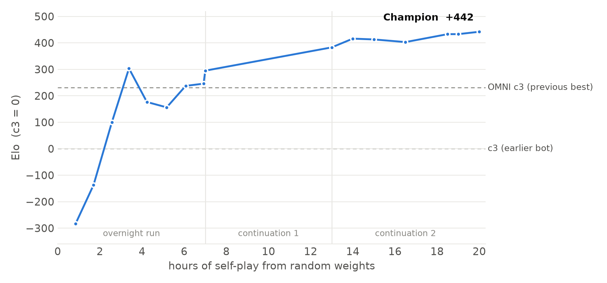

<div align="center">

# polytopia-bot

**The first superhuman [Polytopia](https://polytopia.io) bot, trained from scratch with self-play reinforcement learning.**

[](https://www.python.org/)
[](https://github.com/jax-ml/jax)
[](engine-rs/)
[](https://modal.com)
[](LICENSE)
[](https://polytopia-bot-kappa.vercel.app)
[](https://thekevinz.com/blog/polytopia-bot)

<p align="center">
  
</p>

</div>

---

This repository holds a bot for [The Battle of Polytopia](https://polytopia.io), the turn-based 4X strategy game,
that taught itself to play 1v1 from nothing: no human games, no scripted teacher, no opening book. A
0.5M-parameter network starts from random weights and plays billions of moves against itself. Twenty hours later it
beats every bot we built before it, including the ones bootstrapped from expert play. The full story is in the
blog post, [*Building a Superhuman Polytopia bot using self-play RL*](https://thekevinz.com/blog/polytopia-bot).

- 🏆 **From scratch.** Pure self-play PPO from random initialization. It never sees a human game or a scripted move.
- 🎲 **The game's own rules.** A Rust engine implements Polytopia 2.17.3 for Bardur, 1v1 and four-player
  free-for-all, checked against 27,785 transitions recorded from the game. It feeds 120k+ training samples per
  second to the learner.
- 🥇 **Beats the built-in AI.** The champion won all 48 match games against the game's hardest (Crazy) AI, 24 from
  each seat.
- 🔭 **Fog of war, handled.** The policy sees only what a player would see. An *omniscient* critic sees the whole
  board during training and is thrown away afterwards.
- 🔎 **Turn search.** At play time, a one-turn lookahead over sampled futures adds ~50 Elo to the raw policy.
- 🎮 **Playable.** A mobile-style web Studio to play, watch and replay games, plus
  [a hosted version](https://polytopia-bot-kappa.vercel.app) you can play right now.
- 📦 **Weights included.** The champion (2 MB, with the value head search needs) is in
  [`weights/champion/`](weights/champion/); the newer, stronger raw policy **hero-1v1** (7 MB) is in
  [`weights/hero-1v1/`](weights/hero-1v1/).

## 📊 Results

Elo below is relative to **c3**, our earlier bot, which learned by imitating a scripted player and then trained with
PPO. **OMNI c3** is c3 plus six more hours of self-play with the omniscient critic. It was the strongest bot before
this one.

<p align="center">
  <picture>
    <source media="(prefers-color-scheme: dark)" srcset="assets/elo-curve-dark.png" />
    
  </picture>
</p>

From random weights it passes c3 after about 2.5 hours and draws level with the previous best during its first
7-hour run. Two continuations take it to **+442 Elo**. Points in hours 0-7 are 64-game ladder matches against c3;
later points come from a Bradley-Terry fit over all evaluation games.

Final tournament: 512 games per opponent on mixed map types, with every map played once from each seat.

| Champion vs | Win rate | Elo gap |
|---|---|---|
| itself after 13 h of self-play | 58% | +59 |
| itself after 7 h of self-play | 69% | +147 |
| OMNI c3, previous best | 76% | +211 |
| c3, imitation-bootstrapped | **92%** | +442 |
| **with search** vs OMNI c3 **with search** (200 games) | **81%** | +260 |

**Against the game's own AI.** Under the game's rules, the champion beat Polytopia's built-in Crazy AI 48–0 with
search and 24–0 without it, on fresh Small Dryland maps. Every game ended by capturing the AI's last city, on average
by turn 21. Details: [docs/champion-vs-real-crazy-2026-10-24.md](docs/champion-vs-real-crazy-2026-10-24.md).

**hero-1v1.** A second from-scratch run, a 4× larger network (4 blocks × 128 channels, 1.97M parameters) trained
directly on the game's rules for about 15.5 hours (6.95 billion samples), beats the champion **68%** (+131 Elo) and
every other bot it was tested against, raw policy against raw policy over 128 seat-paired games. It has no fog-of-war value head
yet, so it plays without search; see [`weights/hero-1v1/`](weights/hero-1v1/).

**The game.** Since 2026-10-27 every bot here trains and plays Polytopia's own rules (Steam 2.17.3, game version
123): two Bardur tribes with fog of war and the full tech tree, cities, villages, ruins, navy, diplomacy and cloaks,
on 14×14 boards across ten map types (classic, drylands, pangea, continents, archipelago, water world, lakes,
highlands, jungle, ridge), plus four-seat free-for-all on 18×18. The champion was trained on the earlier research
ruleset (`bardur-1v1-v2`, derived from the open-source [Polyfish](https://github.com/HenBOMB/Polyfish) engine) and
plays the game's rules unchanged. Every rule that changed, and the few known differences that remain, are in
[docs/rules-alignment-2026-10-27.md](docs/rules-alignment-2026-10-27.md) and
[docs/rules-parity-2026-10-31.md](docs/rules-parity-2026-10-31.md) (the game's own map generator, random procedures and
the second pass of rules).

## 🎮 Play it

**In your browser:** [polytopia-bot-kappa.vercel.app](https://polytopia-bot-kappa.vercel.app) serves the champion
with turn search. The server scales to zero when idle, so the first move after a quiet spell can take about two
minutes.

**Locally**, with the Studio (Python 3.11+, Node 20+):

```bash
(cd web && npm install && npm run build)
./scripts/studio.sh --search
```

Then open http://127.0.0.1:8765. *Play the bot* starts a game from either seat, *Watch self-play* lets the champion
play itself, and the *Replay library* opens saved games. On first start the script builds the Rust engine (it needs a
[Rust toolchain](https://rustup.rs)) and search compiles on CPU, which takes a few minutes. The board draws
placeholder shapes; no game graphics ship with this repository. To play hero-1v1 instead, run
`./scripts/studio.sh --checkpoint weights/hero-1v1/final.npz` (no search). See
[docs/replay-studio.md](docs/replay-studio.md).

## 🧠 How it works

**Network.** The input is the player's own fog-of-war view: 14×14 planes for terrain, units, cities and visibility,
plus global features (stars, technologies, turn). A small residual CNN (2 blocks × 64 channels, LayerNorm, SiLU,
mean- and max-pooled global context) feeds an autoregressive action head. The head picks an action family (move,
attack, train, build, research, end turn, …), then a source tile, then a target. Every step is masked to legal
actions. 519,267 parameters. → [`src/polytopia_bot/rl/network.py`](src/polytopia_bot/rl/network.py)

**Self-play PPO.** One policy plays both seats, and sometimes faces a pool of its own past snapshots instead. The
reward is win or loss, plus a Polytopia-score tiebreak if a game reaches the 100-round cap. Credit runs on a *turn
clock*: γ = 0.99 and λ = 0.95 per game turn rather than per action, because one turn can hold dozens of actions.
Each update takes 262k samples, one epoch at minibatch 16k, learning rate 3e-4. Full config:
[`configs/champion.json`](configs/champion.json). → [`src/polytopia_bot/rl/distributed.py`](src/polytopia_bot/rl/distributed.py)

**Omniscient critic.** The value function used for advantages sees *both* players' full state. In our ablations it
was the largest single improvement. This asymmetric actor-critic lets the policy learn under fog of war without the
critic having to guess what is hidden. Search needs a value from the player's own view, so a fog-of-war value head
is fitted afterwards with the policy frozen.

**Distributed training.** CPU containers (8 × 32 processes) run the Rust engine and the policy, and stream
compressed trajectories to one H100 learner. The learner broadcasts new weights every two updates, at about 120k
samples per second overall. The champion is three back-to-back runs (7 h + 6 h + 7 h), totalling 29,397 updates and
7.7 billion samples for under $500 of cloud compute. → [`experiments/modal_distributed_rl.py`](experiments/modal_distributed_rl.py)

**Turn search.** At the start of its turn the bot plays out 16 candidate turns: its greedy turn plus 15 sampled from
the policy. Each candidate continues through the opponent's reply on *determinized* worlds, where hidden
information is resampled to match what the bot can see. The value head scores the results and the bot plays the
best candidate. Hidden state is never visible to the search. → [`src/polytopia_bot/rl/search.py`](src/polytopia_bot/rl/search.py)

## 📦 Install

```bash
uv venv && source .venv/bin/activate
uv pip install -e '.[test,train]'
```

Everything that plays games (Studio, training, arenas, search) needs the Rust engine, a Python extension built with
[maturin](https://www.maturin.rs/):

```bash
(cd engine-rs && maturin develop --release)
```

## 🚀 Train

Training runs on [Modal](https://modal.com): one GPU learner plus CPU actor containers. The scripts expect a Modal
environment named `staging` and two volumes:

```bash
modal environment create staging
modal volume create --env staging polytopia-structured-rl
modal volume create --env staging polytopia-structured-rl-retained
modal volume put --env staging polytopia-structured-rl-retained weights/champion checkpoints/champion
```

Create a randomly initialized parent with the champion's architecture, then train from it:

```bash
modal run --env staging experiments/modal_distributed_rl.py::random_init \
  --reference /retained/checkpoints/champion/final.npz --out /results/scratch/random-init.npz
modal run --detach --env staging experiments/modal_distributed_rl.py::launch \
  --run-id scratch-1 --parent /results/scratch/random-init.npz \
  --config-json "$(cat configs/champion.json)" --actors 8 --actor-cpu 16 --seconds 25200
```

A 7-hour run on 1×H100 plus 8 actor containers costs about $150 on Modal. To continue a run, pass its `final.npz` as
`--parent`, and add `"critic_path": "/results/distributed/<run>/final-critic.npz"` to the config so the omniscient
critic carries over. `scripts/distributed_status.py` reports on a live run.

## 🕹️ Evaluate

```bash
# Seat-paired arena between two checkpoints on fresh maps
modal run --env staging experiments/modal_distributed_rl.py::arena --name champ-vs-x \
  --candidate /retained/checkpoints/champion/final.npz --opponent <other.npz> --maps 64
# Round-robin Bradley-Terry Elo over several checkpoints
modal run --env staging experiments/modal_elo_tournament.py --help
# Turn search against the raw policy, or against another searching bot
modal run --env staging experiments/modal_test_time_search.py::sweep --help
```

Tests run on CPU, either locally or on Modal:

```bash
python -m pytest -q
modal run --env staging experiments/modal_distributed_rl.py::tests --paths tests
```

## 🔬 The engine

The rules live in [`engine-rs/`](engine-rs/), a Rust engine with a batched Python interface
([`src/polytopia_bot/rl/rust_engine.py`](src/polytopia_bot/rl/rust_engine.py)) for 2 or 4 seats. It started as a
hand-written port of a batched JAX engine ([`src/polytopia_bot/gpu/`](src/polytopia_bot/gpu/)), matched it bit for bit
over 12.5 million random steps at 12-17× the speed, and was then aligned with the game's own rules, map generator
and random procedures: it reproduces all 686 recorded positions' legal-move sets, rejects none of 27,785 recorded
commands and matches every rule-relevant field of 19,742 of those transitions, the rest being conventions with no
gameplay effect and a short list of named differences. `tests/test_real_rules.py`
checks each changed rule on a hand-edited position. The JAX engine is retired from play; `gpu/` keeps the state
layout and rule table. See [docs/rules-parity-2026-10-31.md](docs/rules-parity-2026-10-31.md),
[docs/rules-alignment-2026-10-27.md](docs/rules-alignment-2026-10-27.md),
[docs/rust-engine-2026-10-21.md](docs/rust-engine-2026-10-21.md) and [docs/gpu-simulation.md](docs/gpu-simulation.md).

## 🗂️ Repository

| Path | Contents |
|---|---|
| `engine-rs/` | Rust engine: the game's rules, 1v1 and four-seat, used by everything that plays |
| `src/polytopia_bot/rl/` | network, PPO learner and actors, GPU inference server, search, arenas, Elo, four-player |
| `src/polytopia_bot/gpu/` | retired JAX engine: state layout, rule table, map generation, observations |
| `src/polytopia_bot/maps/` | map-type generators and map streams |
| `src/polytopia_bot/studio/`, `web/` | Studio server and its React + PixiJS interface |
| `experiments/` | Modal entry points: training, arenas, Elo tournaments, search sweeps, replay recording |
| `scripts/` | Elo fits, run status, fixture generators, ruleset verification |
| `tools/` | Polyfish oracle builds, Studio asset setup, clip recorder for this README |
| `weights/champion/`, `weights/hero-1v1/` | the two released checkpoints and their metadata |
| `docs/` | rules, engine notes and the research notebook; start at [docs/README.md](docs/README.md) |

The [research notebook](docs/README.md) records each training campaign behind the champion, including the ideas
that didn't pay off: distilling search into the policy, 18×18 boards, UPGO, deeper search, and bigger networks at
equal compute. It also covers the four-player free-for-all runs, the alignment with the game's rules and the
throughput work behind the hero runs.

## 🙏 Acknowledgements

The original rules engine was derived from [Polyfish](https://github.com/HenBOMB/Polyfish) (Apache-2.0); see
[THIRD_PARTY_NOTICES.md](THIRD_PARTY_NOTICES.md). *The Battle of Polytopia* and its art are © Midjiwan AB. This is an
unofficial research project, not affiliated with or endorsed by Midjiwan.

## 📄 License

[Apache 2.0](LICENSE).
