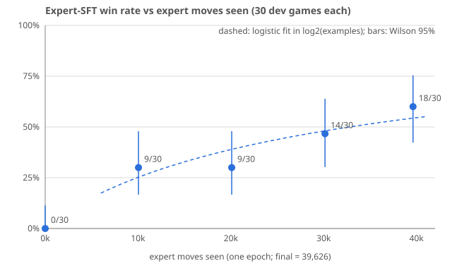

# Expert-SFT data scaling: win rate vs expert moves seen (2026-10-19)

**Headline.** The `expert-sft-v1` LoRA's intermediate checkpoints, re-evaluated on exactly the same 30 development games, win **9, 9, 14 and 18 of 30** at about 25%, 50%, 75% and 100% of the 39,626 expert moves.

- **Still rising at 100%.** The last two quarters of the data added 5 and then 4 wins. There is no plateau.
- **Recommendation for the next run:** use **at least 2× the data (~80k examples)**, and ideally ~4× (~160k) if the 4×B200 budget allows. Use a schedule that lets the curve be read off cleanly (§5).
- **Main caveat:** these are mid-run checkpoints of one cosine-LR run, not separate runs trained to completion on less data. The late gains therefore mix "more data" with "learning rate annealed to 0" (§4).

Summary data: [`expert-sft/scaling-curve-summary.json`](expert-sft/scaling-curve-summary.json). Plot: [`expert-sft/scaling-curve.svg`](expert-sft/scaling-curve.svg).

## 1. Setup

- **Adapters.** All four come from `expert-sft-v1/training/model/` on Modal volume `polytopia-sft0-training` (env `staging`). The intermediate checkpoints are hash-pinned from `run.json` `checkpoints[*].adapter_files`. `checkpoint-620` equals `adapter-final`, and its hashes match [`checkpoint-expert-sft-v1.json`](expert-sft/checkpoint-expert-sft-v1.json).

  | arm | step | examples seen | LR at step | train loss (last 20 steps) |
  |---|---:|---:|---:|---:|
  | ckpt157 | 157 | 10,048 (25%) | 8.8e-5 | 0.266 |
  | ckpt314 | 314 | 20,096 (51%) | 5.1e-5 | 0.259 |
  | ckpt471 | 471 | 30,144 (76%) | 1.4e-5 | 0.249 |
  | final | 620 | 39,626 (100%) | 0 | 0.260 |

- **Jobs.** The 30 `jobs` of `runs/expert-sft-v1/protocol.json`, copied verbatim: 15 validation maps (100691–100705) × 2 seats vs scripted `balanced`.
- **Harness.** Identical to the `expert_sft` arm of `expert-sft-v1`:
  - `scripts/benchmark_expert_sft.py`, run unchanged;
  - readable prompt plus legal-action grammar;
  - same sampling;
  - per-decision seed `17 + rng_index·100000 + decision`;
  - vLLM with LoRA enabled, on one H100 per checkpoint, all arms in parallel.
- **Source integrity.** Every source file hashed by `expert-sft-v1` is unchanged except two:
  - `benchmark_expert_sft.py` gained the `opponent_factory` hook in 567a6aa. It is equivalent for scripted opponents.
  - `summarize_expert_sft.py` changed as well; it is only used for analysis.

  Workers re-checked all hashes before play.
- **Reference arms.** The final-adapter (18/30) and base (0/30) games are reused from `expert-sft-v1`, not replayed.
- **Run.** `expert-sft-scaling-v1`, Modal app `ap-MNrEorqILgzoGM7HAlTBlP`. It used about 4.2 H100-hours, and all 90 games resolved natively. Launcher: [`modal_expert_scaling.py`](../experiments/modal_expert_scaling.py). Its coordinator persists call IDs and reattaches on restart; no restart happened.
- **Statistics.** [`summarize_expert_scaling.py`](../scripts/summarize_expert_scaling.py) reuses the `summarize_expert_sft.py` helpers: paired map-cluster bootstrap, 20,000 resamples. [`report_expert_scaling.py`](../scripts/report_expert_scaling.py) does the fit and the plot.

## 2. Results

| arm | examples | wins | losses | unfinished | median round (all / wins) | median model moves | peak cities (mean / median / max) |
|---|---:|---:|---:|---:|---|---:|---|
| base | 0 | 0 | 30 | 0 | 21.5 / – | 106 | 1.0 / 1 / 2 |
| ckpt157 | 10,048 | **9** | 21 (2 resignations) | 0 | 31.5 / 40 | 402 | 5.8 / 6 / 11 |
| ckpt314 | 20,096 | **9** | 21 | 0 | 35.0 / 33 | 445 | 6.0 / 5.5 / 11 |
| ckpt471 | 30,144 | **14** | 16 | 0 | 36.0 / 28 | 528 | 6.9 / 7 / 11 |
| final | 39,626 | **18** | 12 | 0 | 34.5 / 29.5 | 567 | 7.4 / 8 / 11 |

Paired win-rate differences, clustered by map (15 maps; 95% bootstrap):

| comparison | diff | 95% CI | maps better / worse |
|---|---:|---|---|
| ckpt157 − base | +0.30 | [0.13, 0.50] | 7 / 0 |
| ckpt314 − base | +0.30 | [0.17, 0.43] | 9 / 0 |
| ckpt471 − base | +0.47 | [0.30, 0.63] | 11 / 0 |
| ckpt157 − final | −0.30 | [−0.57, 0.00] | 2 / 8 |
| ckpt314 − final | −0.30 | [−0.50, −0.10] | 1 / 8 |
| ckpt471 − final | −0.13 | [−0.33, 0.07] | 2 / 5 |
| ckpt314 − ckpt157 | 0.00 | [−0.20, 0.17] | 3 / 2 |
| ckpt471 − ckpt314 | +0.17 | [−0.03, 0.37] | 4 / 1 |
| final − ckpt471 | +0.13 | [−0.07, 0.33] | 5 / 2 |

What the numbers say:

- **A quarter of the data already does most of the work against base.** The model goes from 0 to 9 wins, peak cities rise from 1 to ~6, and games last about 400 model moves instead of about 100.
- **Each later quarter helps a bit.** No single adjacent step is significant on 30 games. However, ckpt314 is significantly below final (CI excludes 0), and ckpt157 sits at the edge of significance.
- **Strategy signals improve monotonically.** Mean peak cities go 5.8 → 6.0 → 6.9 → 7.4. Wins come faster: median winning round 40 → 33 → 28 → 29.5. City captures go 266 → 300 → 364 → 365.

## 3. Curve fit

The fit is a per-game logistic regression, `win ~ a + b·log2(examples seen)`, over the four SFT points (120 games). Its uncertainty comes from a map-cluster bootstrap with 4,000 resamples.

- **Slope:** b = **0.64 logit per doubling** (odds ×1.89 per doubling), 95% CI [0.02, 1.37]. The slope is positive in 98% of resamples.
- **Fitted win rate at 1×:** 54% [37%, 70%].
- **Extrapolations** (directional only: one run, n = 30 per point, and the confound in §4):

  | data | examples | predicted win rate vs `balanced` (dev maps) |
  |---|---:|---|
  | 2× | ~79k | 69% [40%, 89%] |
  | 4× | ~159k | 81% [42%, 97%] |

The points do not look concave. The first doubling (10k → 20k) gained nothing, and the last 25% gained the most. The log-linear fit is therefore, if anything, conservative about the tail.

## 4. Caveats

1. **Data and LR annealing are confounded.**
   - These checkpoints come from a single run with cosine LR (1e-4 → 0). ckpt157 was taken at LR 8.8e-5 and has never annealed. The final adapter is fully annealed.
   - A run trained to completion on only 25% of the data would probably beat ckpt157. That makes the true data curve somewhat flatter than this one, and the late gains (14 → 18) partly an annealing effect.
   - The rise from 9 to 14 between ckpt314 and ckpt471 happened while LR was still at 5e-5 → 1.4e-5, so data very likely matters too. This design cannot split the two.
2. **Imitation loss barely moved after 25% of the data.** The per-batch training loss fell from 0.266 to about 0.25–0.26. In a one-epoch run each batch is unseen, so this is close to a held-out imitation loss. Win rate kept improving while the loss did not. Token-averaged loss is a poor proxy for play strength here, so don't size the next run off the loss curve.
3. **Small sample.**
   - There are 30 games per point and one sampling sequence per arm. The final adapter's 18/30 was not replayed, so run-to-run sampling noise is unmeasured.
   - The ±3-win wobble between adjacent points is within noise.
   - These are dev maps vs `balanced` only. The held-out 180-game suite was not run on the checkpoints.

## 5. Recommendation for the next (larger) SFT run

- **Data volume.** The curve is still rising at 100%, so the next run should use **more data, not the same 40k**:
  - Target **~160k examples (4×)**.
  - Fall back to **~80k (2×)** at minimum if training budget is tight.
  - At the observed ~0.18 s per example on 4×B200, 2× is about 3.9 h and 4× about 7.8 h of training.
- **Where more data can come from.** Expert data is cheap: 1,000 expert games took 8 minutes on CPU and yielded 357k decisions, of which we sampled only 40 per game. Prefer more *games* over more samples per game, since consecutive decisions within a game are correlated:
  - the new RL bot vs `pressure`/`economy` as well as `balanced`;
  - more samples per game only as a second step.
- **Make the curve readable.** Use a warmup–stable–decay schedule (constant LR with short cooldown branches) instead of a single cosine run. Then 25/50/100% checkpoints with their own short decay are fair stand-ins for smaller runs, which removes caveat 1.
- **Evaluate checkpoints on the held-out suite.** Score the new run's checkpoints on the 180-game held-out suite, not only the 30 dev games, so adjacent points can be separated.
- **Measure the noise floor.** Replay the final adapter once to measure sampling noise. It costs about 1.1–1.7 H100-hours, which is what each checkpoint arm took here.

## 6. Files

- **Code:** [`experiments/modal_expert_scaling.py`](../experiments/modal_expert_scaling.py), [`scripts/summarize_expert_scaling.py`](../scripts/summarize_expert_scaling.py), [`scripts/report_expert_scaling.py`](../scripts/report_expert_scaling.py).
- **Run receipts:** `runs/expert-sft-scaling-v1/`:
  - protocol, dispatch and coordinator state (`collection.json`);
  - per-arm vLLM runtime receipts;
  - `summary-small.json` with per-job wins.
- **Full per-game summary and traces:** on the volume at `expert-sft-scaling-v1/`.
