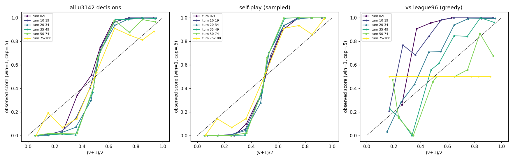
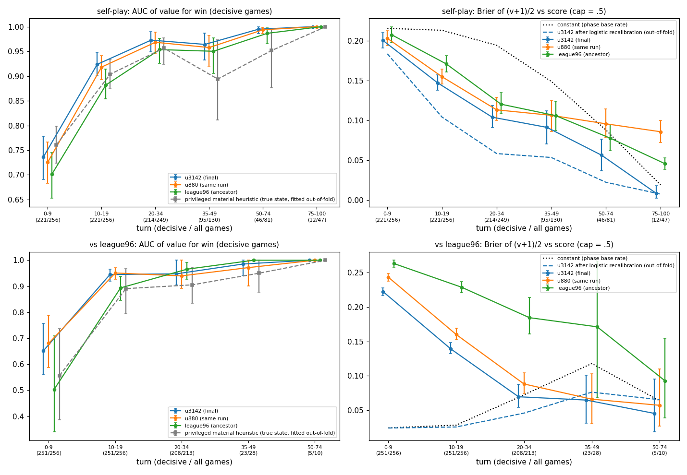
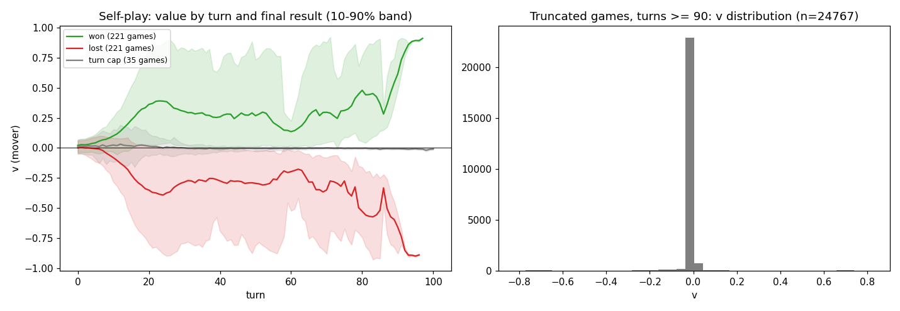
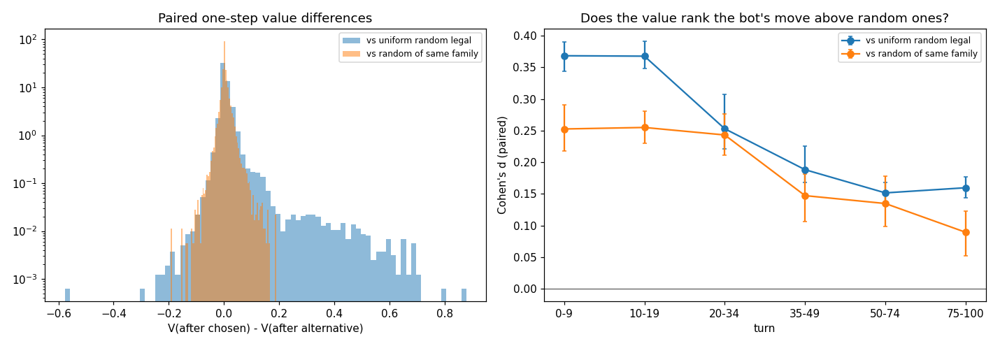
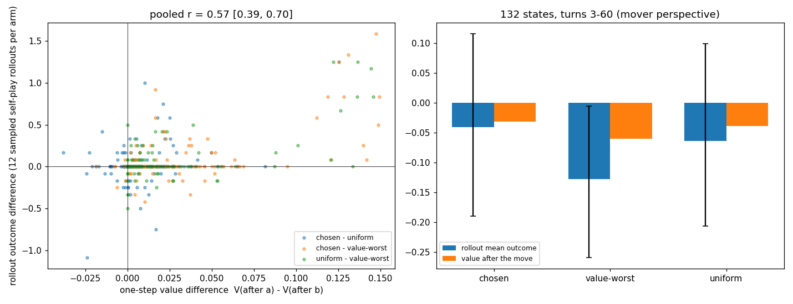
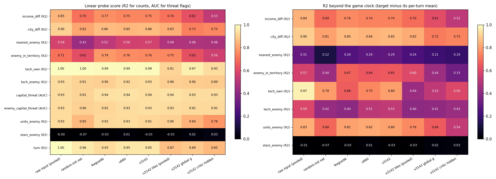
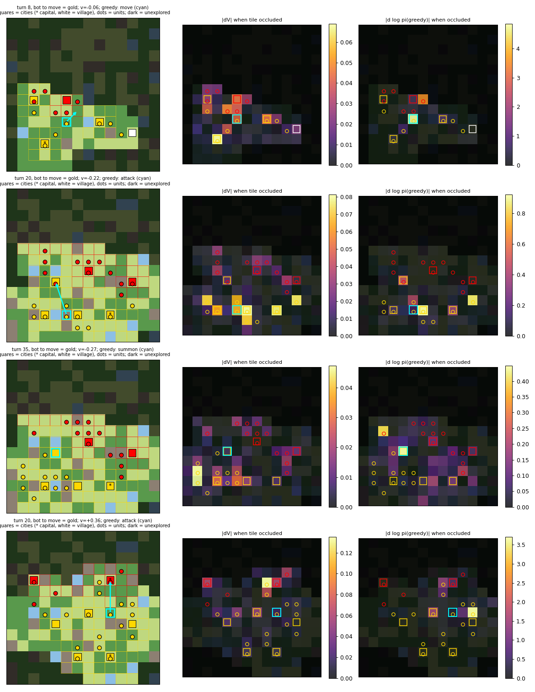

# What does u3142 know? Value calibration, value-difference rewards, concept probes (2026-10-19)

Subject: the delivered PPO bot `dist-c460div-v1` update 3142 (`/retained/checkpoints/distributed-final-v1/dist-c460div-v1-update-3142/final.npz`),
compared with its own earlier snapshot u880 and its ancestor league96. Two later plans lean on its value head:
test-time search (score positions with it) and the LLM transfer study (value change per move as a dense reward,
`docs/transfer-experiment-design-2026-10-18.md`). This report checks whether that is justified.

## Verdict

**As a search heuristic: usable from about turn 10, as a *ranking* of positions; not as a probability.**
- In self-play the value separates eventual winners from losers with AUC 0.92 (turns 10–19), 0.96–0.97 (turns 20–49)
  and ≥0.99 after turn 50. Turns 0–9 are weak (AUC 0.74, |v| ≈ 0.08): the opening is not resolved by the value.
- It is badly scaled as a win probability: it is trained toward γ^k·outcome with γ = 0.995 per own decision and
  games of ~650 decisions per seat, so |v| is shrunk roughly 9–25× in logit terms. In self-play, (v+1)/2 = 0.6
  already means ≈100% wins. A per-phase logistic recalibration p = σ(a·v + b) cuts the Brier score by 30–60%
  (0.147 → 0.104 at turns 10–19, 0.104 → 0.059 at turns 20–34). Search that only compares sibling positions does not
  need this; anything that mixes value estimates with terminal ±1 outcomes, or with each other across very different
  depths/turns, does.
- It does not know the opponent: against league96 (which u3142 beats 95% of the time) early positions with v ≈ 0 are
  in fact near-certain wins. Raw Brier vs league96 is far worse than the constant base rate before turn 20.
- It is not much more than a material count. A linear fit on true-state cities/units/income/threat features explains
  79–86% of the value's variance in turns 10–49, and a logistic "material heuristic" fitted on the *true* state
  (including hidden enemy units/tech) reaches AUC within the value's confidence intervals in every phase; the value's
  point estimate is higher from turn 10 on, most clearly at turns 35–74 (0.96–0.995 vs 0.89–0.95).
- Turn cap: in games that end at the 100-turn cap, the value sits at ≈0 the whole game (mean |v| 0.02 after turn 90).
  v ≈ 0 therefore means "even *or* headed for the cap"; it cannot distinguish them.

**As a per-move dense reward for the LLM study: weak on its own; use it at turn level or as a blunder filter.**
- Per move, the value changes by ~0.01 on average, and the median gap between the bot's move and a random legal
  move is 0.001. The bot's own move gets a higher next-state value
  than a uniform random legal move only 63% of the time (paired Cohen's d = 0.23 [0.21, 0.26]); against a random move
  *of the same kind* (another move, another attack, …) 59% (d = 0.21). It degrades through the game: 67% in turns
  0–19, 59% at turns 50–74, 55% after turn 75.
- It is good at what a material count is good at: research (76% of the time it prefers the bot's choice over a random
  research), city rewards (82%), and big blunders (1.5% of random legal moves score > 0.1 below the bot's move).
  It is blind on building (49%, chance), disbanding (41%, prefers the random one), capture order and recovery (≈50%).
- Along played games, per-move ΔV has a partial correlation with the final result (given the current value) of only
  0.02–0.05; ΔV accumulated over a whole turn correlates 0.36 with the result.
- Independent Monte-Carlo check (132 states, 12 sampled self-play rollouts after each of: the bot's move, the
  alternative the value rates worst, a uniform random move): the value's large claims are real, its small ones are
  not. When the one-step value gap exceeds ~0.1 (~15 of 132 states), rollouts confirm a large outcome gap
  (0.5–1.5); below that, rollout gaps are indistinguishable from zero. Pooled Pearson r = 0.57 [0.39, 0.70] between
  value gap and rollout gap, but rank correlation only 0.24 [0.11, 0.37]. The bot's move vs a uniform random move:
  rollout gap 0.02 [−0.01, 0.06], not significant. The value-worst move really is worse (gap 0.09 [0.05, 0.14]),
  but only in turns 3–14 (0.23 [0.12, 0.35]); from turn 15 on, rollouts show no difference (0.00 and 0.00) while the
  value still claims one. In 60% of sampled states every rollout of every arm ended the same way: under strong play
  most single moves do not change the result.

Recommended reward design for the LLM study: (1) reward per *turn* from the recalibrated value at the start of the
next own turn, not per action; (2) use per-action ΔV only as a negative signal when it drops by more than ~0.1
(blunder detector; this is the range the rollouts confirm); (3) for per-action shaping prefer the policy's own
log-probability of the action (agreement with u3142), which the value only partially tracks (within-state Spearman
between value ranking and policy ranking 0.25); (4) do not use the value before turn ~10, and do not treat v ≈ 0 late
in the game as "equal" (it also means "cap"). Caveat: an LLM player reaches positions these bots never do (more
blunders, slower play), where none of this has been measured.

| Turns | As a search heuristic | As a per-move reward |
|---|---|---|
| 0–9 | weak: AUC 0.74, mean abs(v) ≈ 0.08 | large flagged drops are real (rollout-confirmed for turns 3–14); small ΔV uninformative |
| 10–34 | good ranking (AUC 0.92–0.97); recalibrate before using as a probability | blunder filter only (ΔV gap > ~0.1); P(bot's move > random) 0.65–0.67 |
| 35–74 | very good ranking (AUC 0.96–0.995) | not confirmed by rollouts; P(bot's move > random) 0.59–0.62 |
| 75–100 | AUC ≈ 1 on the few decided games, but v ≈ 0 mostly means "headed for the cap" | useless: mean abs(ΔV) 0.001 |

## Setup

- 512 games on development seeds 331000–331127, frozen engine on CPU (`cpu_engine.CpuGames(fast=False)`, the
  evaluation build), one map type (Bardur Drylands 14×14; there is no other map type in the simulator, so "map type"
  is replaced by capital-distance terciles). Per map: two sampled u3142 self-play games and greedy u3142 vs greedy
  league96 from both seats. Results: self-play 134–87 for seat 1 with 35 turn-cap games; vs league96 244 wins,
  7 losses, 5 caps. 661k decisions logged, mean 1,292 decisions per game.
- At every decision: the mover's value under u3142, u880 and league96 (same position), true-state concepts and the
  final outcome. At 3% of decisions: pooled trunk activations (mean+max over tiles, 128), global vector g (64) and
  critic hidden layer (64) of all three nets plus a random-init net, and the raw pooled input as a baseline.
  At 4% of u3142 decisions: the value after the chosen action and after 4 uniform random legal and 2 random
  same-family alternatives (one-step branches through the real engine).
- Value target for reference: native reward only (+1/−1 at the end, 0 at the cap), γ = 0.995 per own decision,
  λ = 0.99, critic bootstrap at the cap during training. All three nets use the same setup.
- Intervals are 95% bootstrap intervals over games. Code: `scripts/policy_probes.py` (collector),
  `scripts/policy_probes_analysis.py` (analysis), `experiments/modal_policy_probes.py` (Modal app;
  outputs `/results/probes/v1` and `/results/probes/mc1` on volume `polytopia-structured-rl`). Plots and the full
  numeric summary are in `docs/policy-probes-2026-10-19/`.

## 1. Value calibration

Reliability by phase. Self-play (middle): every phase is a steep S-curve through (0.5, 0.5): the ranking is right but
the scale is compressed. Against league96 (right) the curves sit above the diagonal: the value assumes an equal
opponent.

Self-play, u3142 to move (AUC on decisive games, Brier with the cap counted as 0.5):

| Turns | Games (decisive) | AUC u3142 [95% CI] | AUC u880 | AUC league96 | AUC material heuristic* | Brier raw | Brier recalibrated | Brier constant | Recalibration slope |
|---|---|---|---|---|---|---|---|---|---|
| 0–9 | 256 (221) | 0.74 [0.69, 0.78] | 0.73 | 0.70 | 0.76 [0.72, 0.80] | 0.200 | 0.184 | 0.216 | 8.9 |
| 10–19 | 256 (221) | 0.92 [0.90, 0.95] | 0.92 | 0.88 | 0.90 [0.88, 0.93] | 0.147 | 0.104 | 0.213 | 10.2 |
| 20–34 | 249 (214) | 0.97 [0.95, 0.99] | 0.97 | 0.95 | 0.96 [0.92, 0.98] | 0.104 | 0.059 | 0.194 | 13.6 |
| 35–49 | 130 (95) | 0.96 [0.93, 0.99] | 0.96 | 0.95 | 0.89 [0.81, 0.97] | 0.091 | 0.054 | 0.149 | 17.7 |
| 50–74 | 81 (46) | 0.995 [0.99, 1.0] | 0.99 | 0.99 | 0.95 [0.88, 1.0] | 0.056 | 0.022 | 0.088 | 24.6 |
| 75–100 | 47 (12) | 1.0 | 1.0 | 1.0 | 1.0 | 0.009 | 0.008 | 0.019 | 4.8 |

\* logistic regression on true-state city, income, unit, tech differences and capital-threat flags, fitted per phase
out-of-fold by game. It sees hidden enemy units and tech, so it is a privileged baseline.

The recalibration slope is the logistic coefficient a in p = σ(a·v + b): the value behaves like a logit divided by
9–25, consistent with γ^k discounting over hundreds of remaining decisions. Against league96 the raw Brier is 0.22 /
0.14 / 0.07 for turns 0–9 / 10–19 / 20–34 against a constant of 0.025 / 0.029 / 0.073; ranking stays good from turn 10
(AUC 0.95, 0.95).

Value vs its own training target (γ^k · outcome, k = own decisions left): correlation 0.53 at turns 0–9, 0.88 at
10–19, 0.95–0.96 from turn 20 (`calibration_discounted_target.png`). In that sense the critic fits what it was asked to
fit; the probability mismatch is from the discount, not from bad learning.

**Over training:** u3142 ≥ u880 ≥ league96 in AUC and Brier in almost every phase, but the gains are small (AUC
+0.01–0.04 over league96). The value head did not change character during the 3,000 updates of RL.

**Map buckets** (self-play, capital distance terciles ≤7 / 7–8 / >8 tiles, 36/96/124 games): AUC 0.96 / 0.93 / 0.94,
Brier 0.072 / 0.125 / 0.094 (pooled over phases). No map type is clearly harder; close-capital maps have more
cap-length stalemates (50% of positions in capped games).

**Turn cap.**

In the 35 self-play games that ended at the cap the value stays near 0 from start to end (turns ≥ 90: mean |v| 0.02,
1.3% of positions with |v| > 0.5, the two seats' values sum to 0.02). Won and lost games separate by turn ~15 and the
value then hovers around ±0.3 until the decisive collapse, when it goes to ±0.9 within a few turns. After turn 75,
|v| predicts whether a game will be decided or capped with AUC 0.99.

**What the value is made of** (self-play, linear fit of v on standardized true-state concepts): R² 0.47 (turns 0–9),
0.79, 0.86, 0.79, 0.53, 0.47 (turns 75+). The largest coefficients are city difference and unit difference
(≈0.09–0.16 value units per s.d. at turns 10–49), then capital threats (own −0.03 to −0.045, enemy +0.02 to +0.04),
star bank and income. Tech difference contributes almost nothing.

## 2. Value differences as a dense reward

22,104 states (4% of u3142's decisions), each with the value after the bot's move and after alternatives; difference
= V(after bot's move) − V(after alternative), mover's perspective, one step through the real engine.

| Comparison | Pairs | P(bot's move rated higher) | Paired Cohen's d [95% CI] | Median difference | Alternative loses > 0.1 |
|---|---|---|---|---|---|
| vs uniform random legal | 88,416 | 0.633 | 0.23 [0.21, 0.26] | 0.001 | 1.5% |
| … excluding end-turn on either side | 81,898 | 0.637 | 0.25 [0.23, 0.28] | 0.001 | 1.2% |
| … self-play (sampled bot move) | 72,612 | 0.625 | 0.22 | 0.001 | 1.5% |
| … vs league96 (greedy bot move) | 15,804 | 0.671 | 0.31 | 0.005 | 1.7% |
| vs random of the same family | 37,544 | 0.591 | 0.21 [0.19, 0.22] | 0.000 | 0.2% |

By phase (vs uniform random): P = 0.67 / 0.67 / 0.65 / 0.62 / 0.59 / 0.55 and d = 0.37 / 0.37 / 0.25 / 0.19 / 0.15 /
0.16 for turns 0–9 / 10–19 / 20–34 / 35–49 / 50–74 / 75+. Same family: P = 0.63 → 0.54.

By the bot's action family (vs a random action of the same family): research 0.76 (d 0.64), city reward 0.82 (0.52),
attack 0.60, move 0.60, summon 0.56, forest 0.55, harvest 0.55, destroy 0.55, recover 0.50, build 0.49 (d −0.01),
capture 0.46 (n = 46), disband 0.41 (d −0.20).

Along played trajectories (consecutive own decisions): per-move |ΔV| averages 0.01 (0.001 after turn 75); its
correlation with the final result is 0.05–0.13, and only 0.02–0.05 after controlling for the current value. Over a
whole own turn, ΔV correlates 0.36 with the result.

Effect size in plain terms: a reward model that is right 63% of the time on "bot move vs random move" and 59% on
"bot move vs another move of the same kind" carries a real but small signal per action. Because the value and the
policy share a trunk and were trained together, even this agreement is partly circular; the Monte-Carlo check below
is the independent test.

### Monte-Carlo check

Separate run (`montecarlo` entrypoint, tag `mc1`, dev seeds 331200+): sampled u3142 self-play; at random own
decisions in turns 3–60 the value after the bot's move and after 6 uniform random legal alternatives was computed.
States spread over turns were then given three arms (the bot's move, the alternative with the lowest value, one
uniform random alternative), each followed by 12 sampled u3142-vs-u3142 continuations to the end (cap 3,000
decisions; 9% of rollouts hit it and count as 0). 132 states from 44 of 64 workers; the other 20 were lost to a
container preemption and not re-run (cost).

| Pair (a − b) | Mean value gap | Mean rollout outcome gap [95% CI] | Pearson r | Spearman ρ |
|---|---|---|---|---|
| bot's move − value-worst | 0.028 | 0.087 [0.048, 0.139] | 0.62 [0.42, 0.75] | 0.31 [0.13, 0.48] |
| bot's move − uniform random | 0.007 | 0.023 [−0.013, 0.064] | 0.35 [0.00, 0.64] | 0.14 [−0.01, 0.36] |
| uniform random − value-worst | 0.021 | 0.064 [0.029, 0.105] | 0.65 [0.38, 0.79] | 0.25 [0.05, 0.39] |

By turn (bot's move − value-worst): turns 3–14 value gap 0.047, rollout gap 0.23 [0.12, 0.35]; turns 15–29 value gap
0.019, rollout gap 0.00 [−0.01, 0.02]; turns 30–60 value gap 0.014, rollout gap 0.00 [−0.03, 0.04].

- The scatter shows two regimes: a cluster of ~15 states with value gaps of 0.1–0.15, where rollouts show outcome
  gaps of 0.5–1.5 (the value is right and, as in section 1, its scale is compressed ~5–10×), and everything else,
  where the rollout gap is centred on 0 whatever the value says. Pearson r is carried by the first group; the rank
  correlation is weak.
- 60% of states had identical results in all 36 rollouts (22% all won, 27% all lost). Restricted to the other 60
  states, the value-worst move costs 0.19 [0.08, 0.29] in outcome and r = 0.64.
- The value-worst alternative is usually a unit move (69 of 132) or a research (32), rarely end-turn (6).
- The value *level* after a move predicts the rollout mean well (r = 0.78), consistent with section 1.

An earlier, underpowered pass in the main collection (384 states, 4 rollouts per arm, bot's move vs one uniform
random move) gave r = 0.15 [−0.02, 0.32]; it is superseded by this run.

## 3. Concept probes

20,003 positions from 512 games; ridge (counts) or logistic (threat flags) probes, 5-fold cross-validated by game.
Left: plain score. Right: R² after subtracting the target's mean at that turn, so a probe cannot score by reading
the game clock. "raw input" = the same pooling (mean + max over tiles) applied to the network's input planes plus the
global input vector. "random-init" = an untrained network of the same architecture.

| Concept | raw input | random init | league96 | u880 | u3142 | u3142 critic only |
|---|---|---|---|---|---|---|
| star income difference (R² / beyond turn) | 0.85 / 0.84 | 0.70 / 0.70 | 0.77 / 0.76 | 0.75 / 0.74 | 0.75 / 0.74 | 0.52 / 0.51 |
| city count difference | 0.90 / 0.90 | 0.82 / 0.81 | 0.86 / 0.85 | 0.85 / 0.84 | 0.86 / 0.85 | 0.75 / 0.75 |
| nearest enemy unit distance (true, incl. fog) | 0.57 / 0.29 | 0.44 / 0.12 | 0.51 / 0.24 | 0.56 / 0.28 | 0.56 / 0.28 | 0.47 / 0.18 |
| enemy units in own territory | 0.71 / 0.58 | 0.61 / 0.43 | 0.78 / 0.66 | 0.76 / 0.64 | 0.75 / 0.65 | 0.56 / 0.33 |
| own tech count | 1.00 / 0.97 | 1.00 / 0.79 | 0.99 / 0.66 | 0.99 / 0.75 | 0.99 / 0.80 | 0.93 / 0.59 |
| enemy tech count (hidden) | 0.93 / 0.57 | 0.91 / 0.42 | 0.90 / 0.41 | 0.92 / 0.51 | 0.93 / 0.52 | 0.89 / 0.43 |
| own capital threatened (AUC) | 0.93 | 0.91 | 0.94 | 0.95 | 0.94 | 0.93 |
| enemy capital threatened (AUC) | 0.93 | 0.90 | 0.92 | 0.93 | 0.93 | 0.92 |
| enemy unit count (partly hidden) | 0.93 / 0.83 | 0.85 / 0.68 | 0.92 / 0.80 | 0.93 / 0.82 | 0.91 / 0.80 | 0.78 / 0.54 |
| enemy star bank (hidden) | 0.08 | −0.07 | −0.03 | 0.02 | −0.02 | 0.04 |

(nets: all 256 activations; capital threat = an enemy unit within 2 tiles of the capital, 26% of positions.)

What this says:
- Everything tested is linearly decodable, but **none of it more than from the raw inputs**. Pooled inputs already
  count cities, units and territory, and a random network keeps most of that. The trained trunk does not build a
  more accessible representation of these concepts; if anything, the 64-unit critic layer throws part of them away
  (it keeps what the value needs: city difference and enemy unit count, R² 0.75 / 0.78).
- The genuinely learned parts are small but consistent: spatial concepts are better decoded than from a random net
  (enemy units in own territory, beyond turn: 0.43 random → 0.65 u3142, already 0.66 in league96; nearest enemy
  0.12 → 0.24 league96 → 0.28 u880/u3142), and the hidden enemy tech count improves over training (beyond turn 0.41 league96 → 0.51 u880 → 0.52 u3142, close to the 0.57 that raw inputs
  allow). The enemy's star bank is not inferred by anything.
- From league96 to u3142 almost nothing changes (most differences ≤0.02). The 3,000 RL updates changed what the
  policy does with the representation more than the representation itself.
- Caveat: probes see pooled vectors only, so they cannot test per-tile spatial knowledge directly; the occlusion
  study covers that.

## 4. Occlusion

Four positions from two self-play games (turns 8, 20, 35, 20). Each tile was replaced by an unexplored tile and the
change in u3142's value (middle) and in the log-probability of its greedy action (right) recorded. Gold = the bot
to move, red = opponent; cyan = the greedy action.

- The value looks at its own units and cities near the contact line. Own units are 4–8% of tiles but carry 37–51% of
  the total |ΔV|; cities (5% of tiles) 12–28%; visible enemy units (3–6%) 17–24%. Tiles far from the front and
  unexplored tiles contribute nothing.
- Single tiles move the value by at most 0.05–0.14, in line with the small per-move ΔV above.
- The policy is far more local: hiding the acting unit's tile or the target changes log π by up to 1–5 nats, while most of
  the board changes it by < 0.1. Where the value and the policy look at the same tiles (a contested city, the attacked
  unit) they agree.

## Cost and caveats

Modal staging, CPU only (estimate from container lifetimes × list rates, not an invoice): smoke runs ~$0.4; main
collection ~$5.8 (two 32-core containers ~1 h, one preempted, its 16 unfinished workers re-run in a third
container); targeted Monte-Carlo ~$5.5 (two 32-core containers 70–95 min, one preempted and stopped); analysis runs
~$0.9. **Total ≈ $12.5.**

- One map type and one board size; all games are u3142 or league96, so the value is only probed on positions these
  bots reach. A weaker LLM player will reach different positions (more blunders, slower play), where the value has not
  been checked and may be less reliable.
- The dense-reward test uses one-step branches; the mover's value after an end-turn action is computed on a position
  where the opponent is to move, which the critic never sees in training (results with end-turn excluded are given).
- Probe results depend on the pooled readout; a per-tile probe could find more.
- Preemption: Modal restarted one container; the duplicate restart was stopped and the missing workers were re-run
  with the same items and seeds (identical outputs for the workers that finished both times).
