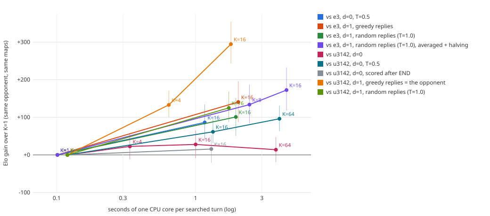

# Test-time search for u3142 (2026-10-19)

Question: without more training, does inference-time search make the best RL bot (u3142,
`/retained/checkpoints/distributed-final-v1/dist-c460div-v1-update-3142/final.npz`) stronger, and how does
strength scale with search budget?

## Answer

- **Yes, with a one-turn lookahead (d=1). The value head on its own does not help much.**
  - Sample K whole turns, let the policy play the opponent's reply, and keep the turn the critic likes best
    afterwards. With K=16 this gives **+141 Elo [+87, +196] vs E3**, a strong bot from another lineage.
    Against raw u3142 it gives **+125 [+87, +168]** with stochastic rollouts and **+295** with greedy rollouts,
    but greedy rollouts are an exact model of a deterministic u3142, so that number is inflated.
  - It costs ~2 s of one Modal CPU core per turn, about 20× the raw policy.
- **Averaging over opponent replies makes d=1 scale with compute** (follow-up, same day). Score each candidate
  over several random replies and spend the replies by sequential halving. K=16 with 64 replies reaches
  **+172 Elo [+118, +233] vs E3** at 4.5 s/turn. That is **+72 [+22, +125] over the same search with one random
  reply** per candidate.
- **Scoring with the critic alone (d=0) barely helps at temperature 1.** K=4/16/64 give +23/+28/+14 Elo vs
  u3142, and none is significant. The critic predicts larger gains as K grows (the optimizer's curse), but they
  never show up in games.
  - Sampling candidates at **T=0.5** fixes part of this: **+61 (K=16) and +96 (K=64) vs u3142**, and **+86 vs
    E3** at K=16.
- **The Gumbel-style root search over the first sub-action failed badly** (−413 Elo). Distinct
  low-prior first actions led the critic astray.
- **No turn-cap stalling.** Search reduces draws: 40/200 truncations in the raw mirror, 14–28 with T=1 search.
- **Caveat that matters for any demo: the search sees through fog of war.** Lanes run on the true engine
  state. With d=1 the rollout opponent plays from its true view, so part of the d=1 gain may come from hidden
  information. A fair version needs determinization (below).
  - **Measured since (addendum below):** without the leak, d=1 K=16 keeps **+82 Elo vs E3** (leaky: +141) and
    **+56 vs u3142** (leaky: +125), at ~4.7 s per turn. About half the gain was hidden information.
- Cost **≈ $24.6** for the main study plus **≈ $5.1** for the robust-search follow-up and **≈ $6.45**
  for the leak-free addendum, all on Modal staging.
  Details are in `runs/test-time-search-v1/budget.json`.



*Elo gain over the K=1 arm (the raw bot) on the same 100 maps × 2 seats, with paired-map bootstrap 95% CIs,
against seconds of one Modal CPU core per searched turn. The "greedy replies = the opponent" series overstates
the gain (see failure modes). Not plotted: root=first (−413), and the league96 arms, which sit at a 93% ceiling
with ±150 Elo CIs (see the tables).*

### Recommendation

| Use | Verdict |
|---|---|
| Worth pursuing as research | **Yes.** The d=1 lookahead is a real gain over the raw policy (+101–141 Elo against opponents it cannot model exactly), and with averaged replies it keeps improving with compute (+172 at 4.5 s/turn). Next steps: (1) a leak-free version, using a determinized opponent rollout that samples hidden enemy units from the searcher's own view (running in a separate session); (2) larger reply budgets and K, d=1 at T=0.5, and `margin` / `prior_coef`, none of which have been swept yet. |
| Stronger demo bot | **Yes for bot-vs-bot demos, not yet vs humans.** Robust K=16 with 64 replies takes ~4.5 s/turn on one Modal core (≈1.5 s on an M-series core); plain K=16 d=1 takes ~2 s. Both are fine for turn-based play. Against a human it would be using hidden information, so ship the leak-free version first, or say so openly. |
| Expert-iteration teacher | **Promising but expensive.** A 20× slowdown per searched decision would cut actor throughput from ~40k samples/s to ~2k at the same fleet size. Distillation would also inherit the fog leak, because the student cannot see what the teacher used. Only the searcher's turn-start decisions need search, so a mix (search on a fraction of turns, AlphaZero-style targets) is the realistic design. Try it after the leak-free search exists. |

## Method

**Search unit = one whole turn.** A Polytopia turn is a variable-length sequence of sub-actions that ends with
END. u3142 plays about 17–19 sub-actions per turn against strong opponents and about 14 against league96.
Searching sub-action by sub-action would mean comparing half-finished turns, which the critic never saw in
training. So the search acts on whole turns (`src/polytopia_bot/rl/search.py`):

1. At the start of the searcher's turn the engine state (an immutable JAX pytree) is copied into K lanes.
2. Lane 0 plays the raw greedy policy, so **K=1 is exactly the raw bot**. Lanes 1..K−1 sample their whole turn
   from the policy at temperature T.
   - Checks: `tests/test_search.py` confirms the same sub-actions as `network.sample(deterministic=True)`.
     Outcomes match `cpu_arena` on the smoke seeds, and the K=1 mirror vs u3142 scores exactly 0.500.
3. Each lane is scored from the searcher's own observation:
   - **d=0:** the critic's value at the decision where the lane chose END. That is the searcher's own turn,
     the kind of state the critic was trained on.
   - **d=0, after END** (`after_end=True`): the critic's value of the searcher's own view of the state just
     after END. Every lane is scored at the same point in time.
   - **d=1:** after END, the opponent's turn is played out by the searcher's own network, greedy unless a
     rollout temperature is set. The lane is scored by the critic at the searcher's next decision.
   - A lane that wins or loses is scored ±1, and a lane that hits the 100-turn cap is scored 0.
4. The best lane's sub-actions are replayed on the real game with the frozen engine, and every replayed action
   must return `core.OK`. Ties keep the greedy lane.

**Root variant ("first", Gumbel-style).** Lanes 1..K−1 take *distinct* first sub-actions, drawn by
Gumbel-top-k over the joint (family, source) prior, with the target chosen greedily. The rest of each turn is
greedy. Options `margin` (a non-greedy lane must beat greedy by this much) and `prior_coef` (add c·log-prior
of the first sub-action) are implemented but were not swept.

Lanes run unbatched under `lax.map` on one pinned CPU core (as in `cpu_engine`), with the exact fast-engine
proposals. The game loop is in `src/polytopia_bot/rl/search_arena.py`. The Modal driver is
`experiments/modal_test_time_search.py`, with one pinned game process per core in 32-core containers. The
analysis and chart come from `scripts/analyze_test_time_search.py`.

**Evaluation.**
- Development seeds only: 360000–360099 vs u3142, 361000–361099 vs league96, and 362000–362099 vs E3
  (`/results/distributed/dist-e340ent-v1/final.npz`, a different lineage), plus 390000–390003 for the smoke
  test. No seed ≥ 400000 was touched.
- Each map is played in both seats, 200 games per arm. Opponents play their raw greedy policy.
- Score = (W + ½·trunc)/N. The Elo gain is measured against the K=1 arm on the same maps, with a 95% CI from a
  paired-map bootstrap.
- Compute is wall-clock seconds of one Modal CPU core per searched turn. Modal cores are ~3× slower than an
  M-series core.

## Results

"override" = the share of turns where search played a non-greedy lane. "lane steps" = simulated engine steps
per searched turn.

### vs raw u3142 (mirror; K=1 = 80–80–40)

| arm | K | d | T | W–L–trunc | score [95% CI] | Elo vs K=1 [95% CI] | s / turn | lane steps / turn | override | $ |
|---|---:|---:|---:|---|---|---|---:|---:|---:|---:|
| k1 (raw) | 1 | 0 | – | 80–80–40 | 0.500 | — | 0.12 | 19 | 0.00 | 0.84 |
| k4 | 4 | 0 | 1.0 | 95–82–23 | 0.532 [0.48, 0.58] | +23 [−12, +56] | 0.34 | 71 | 0.65 | 0.95 |
| k16 | 16 | 0 | 1.0 | 99–83–18 | 0.540 [0.49, 0.59] | +28 [−9, +65] | 1.00 | 272 | 0.89 | 1.10 |
| k64 | 64 | 0 | 1.0 | 90–82–28 | 0.520 [0.47, 0.57] | +14 [−19, +47] | 3.79 | 1178 | 0.95 | 2.63 |
| k16, scored after END | 16 | 0 | 1.0 | 95–86–19 | 0.522 [0.47, 0.57] | +16 [−21, +53] | 1.30 | 295 | 0.89 | 1.11 |
| k16 | 16 | 0 | 0.5 | 99–64–37 | 0.588 [0.55, 0.63] | **+61 [+31, +94]** | 1.33 | 297 | 0.88 | 1.23 |
| k64 | 64 | 0 | 0.5 | 108–54–38 | 0.635 [0.59, 0.68] | **+96 [+63, +131]** | 4.01 | 1239 | 0.94 | 2.13 |
| k4, greedy rollout | 4 | 1 | 1.0 | 119–46–35 | 0.682 [0.64, 0.73] | +133 [+100, +171]* | 0.64 | 153 | 0.66 | 1.05 |
| k16, greedy rollout | 16 | 1 | 1.0 | 162–24–14 | 0.845 [0.80, 0.89] | +295 [+244, +354]* | 1.80 | 570 | 0.89 | 1.27 |
| k16, rollout T=1 | 16 | 1 | 1.0 | 123–54–23 | 0.672 [0.62, 0.72] | **+125 [+87, +168]** | 1.73 | 584 | 0.89 | 1.28 |
| k16, root=first | 16 | 0 | – | 13–179–8 | 0.085 [0.05, 0.12] | −413 [−512, −338] | 0.81 | 222 | 0.93 | 0.81 |

\* The rollout policy is exactly the opponent (deterministic u3142), so the search predicts the opponent's
reply perfectly. These two rows are upper bounds, not strength.

### vs E3 (`dist-e340ent-v1` final, raw u3142 already 57.5%)

| arm | K | d | T | W–L–trunc | score [95% CI] | Elo vs K=1 [95% CI] | s / turn | $ |
|---|---:|---:|---:|---|---|---|---:|---:|
| k1 (raw) | 1 | 0 | – | 94–64–42 | 0.575 [0.53, 0.62] | — | 0.10 | 0.71 |
| k16 | 16 | 0 | 0.5 | 123–47–30 | 0.690 [0.64, 0.74] | **+86 [+41, +134]** | 1.16 | 1.12 |
| k16, greedy rollout | 16 | 1 | 1.0 | 140–39–21 | 0.752 [0.70, 0.80] | **+141 [+87, +196]** | 2.03 | 1.80 |

### vs league96 (raw u3142 already 93%; ceiling, wide CIs)

| arm | K | d | W–L–trunc | score [95% CI] | Elo vs K=1 [95% CI] | s / turn | $ |
|---|---:|---:|---|---|---|---:|---:|
| k1 (raw) | 1 | 0 | 186–13–1 | 0.932 [0.90, 0.96] | — | 0.09 | 0.73 |
| k4 | 4 | 0 | 183–14–3 | 0.922 [0.89, 0.95] | −26 [−134, +72] | 0.26 | 0.81 |
| k16 | 16 | 0 | 193–6–1 | 0.968 [0.94, 0.99] | +133 [+0, +363] | 0.87 | 0.85 |
| k64 | 64 | 0 | 188–10–2 | 0.945 [0.91, 0.97] | +38 [−81, +174] | 3.33 | 1.25 |
| k4 | 4 | 1 | 190–8–2 | 0.955 [0.93, 0.98] | +75 [−32, +197] | 0.66 | 1.17 |
| k16 | 16 | 1 | 190–9–1 | 0.953 [0.92, 0.98] | +65 [−58, +215] | 1.39 | 1.02 |

league96 cannot separate the arms: every search arm is within the CI of the raw bot's 93%.

### Compute

| K | s / searched turn, d=0 | d=1 | one game (~45 searched turns), d=1 |
|---:|---:|---:|---:|
| 1 | 0.09–0.12 | – | ~5 s |
| 4 | 0.26–0.34 | 0.64–0.66 | ~30 s |
| 16 | 0.87–1.33 | 1.4–2.0 | ~80 s |
| 64 | 3.3–4.0 | (not run) | – |

- Cost is linear in K: ~3.7 ms per lane step on one Modal core, including the policy forward and fast masks.
  d=1 costs about 2× d=0, and "after END" scoring adds ~30% (an extra encoder pass).
- A single process compiles in ~170 s, a one-off per K and per mode.

### Robust d=1: averaged replies + sequential halving (follow-up)

Motivated by failure mode 1 below (the optimizer's curse), d=1 gets AlphaZero-style defenses
(`replies=n` in `build_planner`):
- The K candidate turns are played to END once.
- Each candidate is then scored by the *mean* critic value over several random opponent replies (rollout
  T=1), not one.
- n replies are spent by sequential halving: K survivors, then K/2, …, 2, with the same reply lanes per round,
  so survivors get more replies each round.
- The greedy turn always survives. The final pick is the best mean, which must beat the greedy turn's mean by
  `margin` (0 here).

All arms are vs E3 on 362000–362099, paired with the same K=1 baseline (94–64–42):

| arm | K | replies | W–L–trunc | score [95% CI] | Elo vs K=1 [95% CI] | s / turn | lane steps / turn | override | predicted gain / turn | $ |
|---|---:|---:|---|---|---|---:|---:|---:|---:|---:|
| d=1, one greedy reply (v2) | 16 | 1 | 140–39–21 | 0.752 [0.70, 0.80] | +141 [+87, +196] | 2.03 | 618 | 0.89 | 0.033 | 1.80 |
| d=1, one random reply | 16 | 1 | 132–49–19 | 0.708 [0.66, 0.76] | +101 [+51, +151] | 1.95 | 564 | 0.89 | 0.041 | 1.12 |
| robust | 8 | 32 | 138–40–22 | 0.745 [0.70, 0.80] | +134 [+84, +187] | 2.44 | 700 | 0.76 | 0.019 | 1.48 |
| robust | 16 | 64 | 147–33–20 | 0.785 [0.74, 0.83] | **+172 [+118, +233]** | 4.51 | 1498 | 0.87 | 0.024 | 2.41 |

Paired head-to-head on the same maps:
- robust K16/64 vs one random reply K16: **+72 [+22, +125]**
- robust K8/32 vs one random reply K16: +33 [−16, +81], at about the same compute
- robust K16/64 vs robust K8/32: +39 [−17, +96]
- one random reply vs one greedy reply, both K16: −40 [−91, +7]

Reading:
- **Averaging works the way the optimizer's-curse explanation predicts.** The search's predicted gain over
  the greedy turn roughly halves (0.041 → 0.019–0.024), so it overrates its picks less.
- **Real strength rises with budget:** +101 → +134 → +172 at 2.0 → 2.4 → 4.5 s/turn. This is the first
  setting where more compute keeps paying off.
- At equal compute (~2.4 s), averaging over fewer candidates is not yet clearly better than one reply for
  more candidates (+33, CI spans 0). The gain shows up when the budget grows.
- Greedy replies looked slightly better than random single replies vs E3 (n.s.). With one reply, the greedy
  reply is a lower-variance estimate.
- All of these still run on the true state (fog leak), like every other arm in this report.

## Failure modes

1. **Optimizer's curse at d=0.**
   - The critic's predicted gain of the chosen turn over the greedy turn grows with K: +0.013 (K=4), +0.024
     (K=16), +0.032 (K=64) per turn vs u3142.
   - Search overrides the greedy turn 65–95% of the time. Realized strength stays flat (+14 to +28).
   - The critic's noise across on-policy alternative turns is about as large as their true differences, so a
     larger K mostly picks lanes the critic overrates.
   - Lowering T to 0.5 keeps candidates near the greedy turn, so when the critic picks wrongly it costs less.
     That arm is the first d=0 setting that scales with K (+61 → +96).
2. **Scoring time is not the culprit.**
   - Sampled turns at T=1 are shorter (15.9–16.4 sub-actions vs 19.0 greedy) and recruit slightly more
     (2.1 vs 1.9 units/turn).
   - A plausible suspect was that END-decision values give credit for actions not yet taken. Scoring every lane
     at the same point (after END) gave the same result (+16 [−21, +53]), with turns just as short (16.2), so
     that hypothesis is refuted.
3. **Off-distribution candidates break the critic (root=first).**
   - Forcing *distinct* first sub-actions pushes most lanes into actions the policy almost never takes.
   - The critic still rates those lanes higher. Overrides hit 93%, turns shrank to 9 sub-actions, recruiting
     fell to 0.9 units/turn, and the bot lost 179 of 200 games in ~20 turns.
   - Likely mechanism: the critic is confidently wrong on states the policy never reaches. That is a plausible
     reading, not one we tested separately.
   - Any root search here needs prior regularization (Gumbel-MuZero's `logits + σ(q)` selection; `prior_coef`
     here) or must stay close to the policy (T ≤ 0.5).
4. **Value-head calibration.**
   - In the u3142 mirror, the greedy-turn critic score is well calibrated on average. Its mean is within ~0.03
     of the mean outcome in every turn bucket.
   - Against E3 it underestimates u3142's edge by 0.08–0.13 through turn 59 (V ≈ 0.02–0.03 vs outcome
     0.10–0.15), and it is calibrated after that.
   - Its correlation with the final outcome is 0.45–0.52 in turns 0–9, rising to 0.6–0.87 later.
   - Against league96 it is badly underconfident early: mean V ≈ 0.03 in turns 0–9 while the outcome is
     +0.87. The critic does not know who it is playing, which matters little for ranking turns.
   - No late-game miscalibration showed up. Most games still going after turn 80 drift to the cap with V ≈ 0,
     consistent with truncation scored as 0. The critic was trained with bootstrap at the cap, so it has no
     explicit notion that the cap is a draw. Search never exploited this.
5. **No stalling into turn-cap draws.** Truncations fall with search: 40 → 14–28 (T=1) vs u3142, and 42 → 21–30
   vs E3. T=0.5 keeps more draws (37–38), since the chosen turns stay close to the greedy mirror.
6. **Information leaks (not measured, bounds the claims).**
   - Fog: lanes see the consequences of moving into fog and the seeded ruin rewards before committing.
   - With d=1, the rollout opponent acts on its true observation, so the score reflects the opponent's hidden
     units.
   - Opponent model: the greedy-rollout d=1 arms vs deterministic u3142 predict the reply exactly. Switching to
     stochastic rollouts cut the gain from +295 to +125.
   - The E3 numbers avoid the opponent-model leak but not the fog leak.

## Reproduce

```bash
modal run --env staging experiments/modal_test_time_search.py::tests
modal run --env staging experiments/modal_test_time_search.py::smoke --seeds 390000,390001,390002,390003 --lanes 4
modal run --detach --env staging experiments/modal_test_time_search.py::sweep --tag v1 --spec-json runs/test-time-search-v1/spec-v1.json --per-container 64
modal run --env staging experiments/modal_test_time_search.py::fetch --tag v1
python scripts/analyze_test_time_search.py runs/test-time-search-v1/v1 runs/test-time-search-v1/v2 runs/test-time-search-v1/v3b runs/test-time-search-v1/v4 --svg docs/test-time-search-2026-10-19.svg
```

- Arm specs (`spec-v1/v2/v3.json`), per-game rows with critic traces, and the cost ledger are in
  `runs/test-time-search-v1/`, which git ignores, and on the `polytopia-structured-rl` volume under
  `/results/test-time-search/{v1,v2,v3b}/`.
- v1 ran 13 arms at 32 cores / 64 GiB, v2 ran 6 arms at 32 cores / 40 GiB, v3b ran 1 arm, and v4 (robust
  d=1, `spec-v4.json`) ran 3 arms at 32 cores / 40 GiB. v3 failed at compile (a Python-bool `~` bug, fixed)
  and was relaunched as v3b.

## Cost

Estimated from container wall time × (32 cores × $0.0472/h + memory × $0.008/GiB-h). This is not an invoice,
and Modal may also bill CPU above the requested cores.

| Item | $ |
|---|---:|
| v1 sweep | 14.90 |
| v2 sweep | 7.83 |
| v3b | 1.11 |
| v3 (failed) | 0.37 |
| smokes and test runs | 0.35 |
| orchestrators | 0.05 |
| **main study total** | **≈ 24.6** |
| v4 robust-d=1 sweep (follow-up) | 5.01 |
| v4 test run | 0.06 |
| v5 leak-free addendum | 6.45 |
| **grand total** | **≈ 36.2** |

## Addendum: leak-free search (determinization)

Question: how much of the d=1 gain survives when search can no longer see through fog of war?

### Answer

- **About half.** With determinized search, d=1 K=16 is still a clear gain over the raw bot:
  - **+82 Elo [+30, +139] vs E3.** The leaky search got +141 [+87, +196].
  - **+56 [+21, +92] vs u3142** with stochastic rollouts. The leaky search got +125 [+87, +168].
- On the same maps, the leak-free arm is **58 [6, 114] Elo weaker than the leaky one vs E3** and **69 [19, 122]
  weaker vs u3142**. So hidden information was roughly 40–55% of the measured gain.
- Leak-free search re-plans after every reveal, so it costs **~4.7 s of one Modal core per turn**, ~2.4× the
  leaky search and ~45× the raw policy.
- **For a human-facing demo, use `determinize=True`** and quote +56 to +82 Elo, not +125 to +141.
- **Not yet measured: leak-free robust d=1.** Robust d=1 (`replies=64`, the section above) reached +172 vs E3
  while still leaky. `determinize=True` also works with `replies` (tested in `tests/test_belief.py`), but no
  games have been run with the two combined.
- **For an expert-iteration teacher,** the leak-free teacher is what the student can actually imitate. It gives
  about half the gain at about 2.4× the cost per searched decision.

### How it works

`TurnSearcher(determinize=True)` (`src/polytopia_bot/rl/belief.py`, plus a small hook in
`src/polytopia_bot/rl/search.py`):

1. **One sampled world per plan.** Before the K lanes are created, the true state is mapped to a world that is
   consistent with the searcher's own observation. A test checks that `kernels.observe` gives exactly the same
   view of the true state and of the sample. All lanes share this world, so lanes are compared on equal footing.
2. **The plan is cut at the first surprise.** The chosen lane's sub-actions are replayed on the true game and on
   the sampled world side by side, with the frozen engine. Replay stops right after the first sub-action whose
   result the searcher sees differently in the two (a move into fog, a ruin reward, a hidden unit). It also stops
   before any sub-action the true game rejects.
3. **Re-plan.** The searcher then samples a new world from what it now sees and plans the rest of the turn.
   That averaged 2.2–2.3 plans per searched turn.

With K=1 this reproduces the raw greedy bot exactly; `tests/test_belief.py` checks it.

**What the sampled world replaces:**
- Unexplored tiles: terrain, villages, ruins and resources come from a fresh map generator draw with a random
  seed.
- Crop and metal that the searcher's tech cannot see are redrawn.
- Enemy units in fog, and invisible enemy units, are removed. Two kinds are kept because the searcher already
  knows about them: invisible units that `detect` flags, and invisible units on the searcher's own city tile,
  which the true legal-action mask exposes (the raw bot gets that mask too).
- Enemy cities whose tile and territory are all unseen move to random sampled village sites in the fog, with
  the capital first.
- The enemy's stars and tech are set by symmetric priors (the searcher's own banked stars and its own tech).
- The enemy's explored set becomes "the tiles the searcher has seen, plus the enemy's current vision".
- The engine's RNG seeds, which decide ruin rewards and explorer paths, are redrawn.

**Residual leaks (small, documented in `belief.py`):**
- How many enemy cities exist and their internals (level, population, rewards).
- Internals of seen enemy units (kills, passenger, status effects).
- The enemy's score, monuments and diplomacy flags.

**The prior is crude.** No enemy units are imagined in the fog. A better belief, such as sampling plausible
enemy units, could recover part of the lost Elo. So the gap between the two arms is "leak + belief error", and
+56 to +82 is what this belief achieves, not a ceiling.

**Fallback.** If nine sampled worlds in a row all start with a sub-action the true game rejects, the searcher
commits one sub-action planned on the true state, and the game row counts it as `fallbacks`. This never
happened in the 400 evaluation games.

The first smoke run found exactly one case of this. An enemy Cloak stood on the searcher's city, the sample had
removed it, every lane wanted to train a unit there, and the true game refused. Keeping such units in the
sample fixed it.

### Results

Same protocol as the main study: 100 development maps × 2 seats per arm, opponents play their raw greedy policy.
The Elo gain is measured against the K=1 arm on the same maps, with a 95% CI from a paired-map bootstrap.

| opponent | arm | rollout | W–L–trunc | score [95% CI] | Elo vs K=1 [95% CI] | s / turn | plans / turn | $ |
|---|---|---|---|---|---|---:|---:|---:|
| E3 (seeds 362000–362099) | raw K=1 | – | 94–64–42 | 0.575 [0.53, 0.62] | — | 0.10 | 1 | 0.71 |
| | leaky d=1 K=16 | greedy | 140–39–21 | 0.752 [0.70, 0.80] | +141 [+87, +196] | 2.03 | 1 | 1.80 |
| | leaky d=1 K=16 (v4, other session) | T=1 | 132–49–19 | 0.708 [0.66, 0.76] | +101 [+51, +151] | 1.95 | 1 | 1.12 |
| | **leak-free d=1 K=16** | greedy | 122–48–30 | 0.685 [0.63, 0.73] | **+82 [+30, +139]** | 4.73 | 2.21 | 2.73 |
| u3142 (seeds 360000–360099) | raw K=1 | – | 80–80–40 | 0.500 | — | 0.12 | 1 | 0.84 |
| | leaky d=1 K=16 | T=1 | 123–54–23 | 0.672 [0.62, 0.72] | +125 [+87, +168] | 1.73 | 1 | 1.28 |
| | **leak-free d=1 K=16** | T=1 | 103–71–26 | 0.580 [0.53, 0.63] | **+56 [+21, +92]** | 4.64 | 2.30 | 2.66 |

**Leak-free minus leaky, paired on the same maps:**
- vs E3, greedy rollouts: −58 [−114, −6].
- vs u3142, T=1 rollouts: −69 [−122, −19].
- Leak-free (greedy rollouts) vs the other session's leaky T=1 rollouts, vs E3: −18 [−69, +32]. That pair also
  differs in rollout temperature, so it is context only.

Other observations:
- **Truncations** rise slightly vs E3 (21 → 30). That is still fewer than the raw bot's 42.
- **Sub-actions per turn** stay at ~17.7, unchanged.
- **Override rate** stays at 0.87–0.89, also unchanged.

### Reproduce and cost

```bash
modal run --env staging experiments/modal_test_time_search.py::tests --paths tests/test_belief.py,tests/test_search.py
modal run --detach --env staging experiments/modal_test_time_search.py::sweep --tag v5 --spec-json runs/test-time-search-v1/spec-v5-determinized.json --per-container 64
modal run --env staging experiments/modal_test_time_search.py::fetch --tag v5
```

- Results are on the `polytopia-structured-rl` volume under `/results/test-time-search/v5/`.
- Smoke runs are under `v5-smoke` (failed on the Cloak case) and `v5-smoke2`.

| Item | $ |
|---|---:|
| v5 sweep (2 arms, 8 containers × 32 cores) | 5.39 |
| smokes (`v5-smoke` failed early, `v5-smoke2` 8 games) | ≈ 0.75 |
| Modal test runs (2 × 4 cores) and an 8-game rejection diagnostic (2 cores each) | ≈ 0.31 |
| **addendum total** | **≈ 6.45** |
